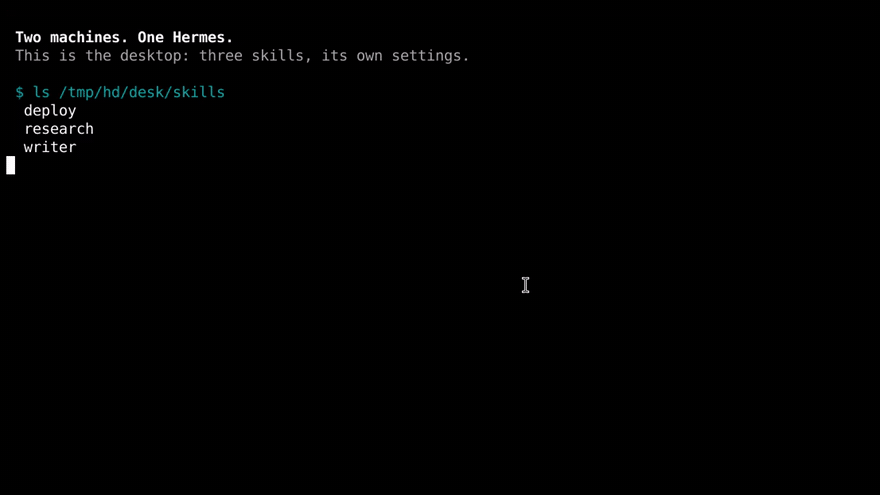

# Herd

**Two machines. One Hermes.**

Settings, skills and memory follow you between machines; each machine keeps the parts that only make sense on it. One command to start, one code to join, nothing to manage afterwards.

> Copying `~/.hermes` moves your Docker socket and your bot token with it. Herd moves the profile, not the machine.

[](docs/media/herd-demo.mp4)

*89 seconds, real commands: pairing, the machine-bound split, a conflict settled with one key, undo. The film is the 1.1 cut and still shows API keys travelling; 1.2 does not sync keys.*

## The short version

| | |
|---|---|
| **What it is** | A plugin that keeps one Hermes across your machines — the same model, skills and memory everywhere, each machine keeping its own paths, ports and bot tokens |
| **What it fixes** | A second machine is a stranger with the same name; copying the folder to fix that moves the first machine's Docker socket and bot token with it |
| **How it works** | One encrypted store, one short pairing code, a per-key merge that knows what belongs to the machine, and a pull at session start / push at session end |
| **What it costs** | You keep the recovery code in a password manager (the pairing code is only for the other machine). Sessions and cron stay put. A real conflict is shown, then one key settles it |

New here? [`PROBLEM.md`](docs/PROBLEM.md) is the case for it, [`COMPARISON.md`](docs/COMPARISON.md) ranks it against every other way to do this, and [`DEMO.md`](docs/DEMO.md) is the 89-second film, shot by shot.

## In the wild

**Laptop and a VPS.** You work from the laptop; the VPS runs the always-on agent. Install on both, `hermes sync pair` on the VPS, paste the code on the laptop. The laptop answers with the same memory and the same skills, while the VPS keeps its daemon socket and the laptop keeps its own working directory. Edit a skill on the train; it is on the VPS at the next session start.

**Desktop plus a travel laptop.** The desktop has the big model and the local models; the travel laptop is a thin client. Settings follow, so it is the same agent — but the travel laptop does not inherit a Docker backend it cannot run, and its bot token does not start answering for the desktop.

**A replacement machine.** `pair` with the code and the profile comes back in one command: memory, skills, `SOUL.md`, config, and the keys if you turned them on. The values you set again are the ones that belong to the new machine anyway.

The common shape: **you stop choosing which machine to work on.** Every machine is the agent; only the plumbing differs.

And the first ninety seconds are one command that prints one short code, one paste, and a line that tells you it worked:

```
$ hermes sync pair
Ready to pair — desktop is the first machine.
  code   QK7M2-9XPRT-4HWBJ-2M8ZC   (once, 15 minutes)

$ hermes sync pair --code QK7M2-9XPRT-4HWBJ-2M8ZC
Paired with desktop. This machine is laptop.
  In sync · 2 machines · synced just now
```

## When you don't need this

If every machine is a *client* of one central Hermes — a box you reach over Tailscale or SSH — you already have one agent; the clients only render it. Herd is for two or more independent installs that have to agree.

And if you run each machine as its own profile but you are tired of explaining the same context three times, pair in knowledge mode: **skills and memory travel, settings stay put.**

```bash
hermes sync pair --knowledge          # first machine
hermes sync pair --code … --knowledge # the others
hermes sync scope profile             # back to the whole profile, any time
```

## The problem, in numbers

- **24% of a real config is machine-bound** — 37 of 155 leaf keys across 12 sections. Copy them and the laptop runs commands in the desktop's Docker socket, binds its port, and answers its Telegram messages.
- **Secrets are all or nothing in a file sync.** Skip `.env` and you retype every key; include it and it lands in a cloud folder or a git history. A published sync tool did exactly that once: *"it read the .env file and posted the contents to slack."*
- **File sync keeps the last write.** Two machines editing the same setting is not an edge case, it is Tuesday. One edit disappears and nothing says so.

The measured detail, including the four prior attempts that all move files: [`PROBLEM.md`](docs/PROBLEM.md).

## What it solves

| Problem | Without Herd | With Herd |
|---|---|---|
| Second machine is empty | Retype keys, reinstall skills, re-teach memory | `join` with the code, once |
| Machine-bound settings | Copied and wrong, or excluded and missing | Resolved to each machine's own value |
| Secrets | Plaintext in a cloud folder, or never synced | Left on each machine. Herd does not read or write `.env` |
| Simultaneous edits | Last write wins, silently | A card in the terminal: `1` keep mine, `2` take theirs — the disagreement is recorded until you choose |
| A mistake | Restore from a backup you may not have | `hermes sync undo` |

## How it works

```
        desktop                          laptop
   ┌──────────────┐                ┌──────────────┐
   │ config.yaml  │                │ config.yaml  │
   │ skills/      │                │ skills/      │
   │ memories/    │                │ memories/    │
   │ SOUL.md      │                │ SOUL.md      │
   └──────┬───────┘                └──────┬───────┘
          │   merge per key, base = last agreed   │
          └────────────────┬──────────────────────┘
                           ▼
                 ┌───────────────────┐
                 │  encrypted store  │  folder, git, Dropbox, USB
                 │  ciphertext only  │  one recovery code opens it
                 └───────────────────┘
```

1. **`init`** creates the store, seals this machine's items, and prints one recovery code (`HERD-…`).
2. **`join`** on the next machine adopts the herd on its first pull.
3. From then on a session-start hook pulls and a session-end hook pushes: a background thread, at most once every two minutes, a couple of milliseconds of hook.

Each device writes exactly one manifest, so two machines pushing at once cannot clobber each other. Items are content-addressed and encrypted, and every change records the entry it was built on — that is how a fast-forward is told from a real disagreement.

`config.yaml` merges per key against the last **agreed** snapshot:

```
local == remote   keep it
local == base     take remote      only they changed it
remote == base    keep local       only you changed it
all three differ  keep local, record both, stop republishing
```

Machine-bound paths are resolved to the local value *before* that comparison — including when the remote payload omits them — so a pull cannot delete the section your machine is running on.

## How it improves Hermes

- **The surfaces stop competing.** CLI, TUI, desktop, webapp, 21+ messaging platforms: without shared state each one boots a different agent, and a new surface loses to the first one. With it, they are the same agent in different windows.
- **The catalog becomes portable.** Skills, automations and connectors are per-host today; make state portable once and every plugin that stores state inherits it.
- **The agent can answer for itself.** Three tools — `sync_status`, `sync_diff`, `sync_now` — so "am I in sync?" is a question Hermes answers, not a command you have to remember.
- **No daemon, no port, no server.** The store is a folder. Session start and session end each start one short-lived background thread (a pull or a push, at most once every two minutes) and that thread exits. Cron and other non-interactive sessions do not start it.
- **It is reversible.** Every pull leaves a backup, and `hermes sync undo` puts the files back.

## How it compares

| Tool | Machine-bound keys | Secrets | Conflicts | Score |
|---|---|---|---|---|
| **Herd** | Modelled per key | Not synced | Kept, then one key to settle | **77** |
| Dotfiles + age/SOPS | Hand-written templates | Encrypted in git | Git conflict, by hand | 59 |
| Syncthing / Dropbox | Copied over each other | Provider-side, plaintext | Conflict copies, `.db` corruption | 51 |
| Shared home over SSH | One config for all hosts | Stays on the server | None to resolve | 51 |
| `hermes profile export/import` | Whole archive | Whole archive | None — one-way | 46 |
| Copy `~/.hermes` | Copied, breaks the host | Leaks or is skipped | Last write wins | 45 |

Full method, weights and per-tool verdicts — including when *not* to use Herd: [`COMPARISON.md`](docs/COMPARISON.md).

## Install

```bash
# both machines
hermes plugins install welliv/hermes-herd --enable

# first machine: creates the herd and prints one short code
hermes sync pair

# every other machine: type the code
hermes sync pair --code XXXX-XXXX-XXXX-XXXX
```

```
Ready to pair — desktop is the first machine.
  store  /root/herd-store

  code   QK7M2-9XPRT-4HWBJ-2M8ZC
         works once, for 15 minutes.

On the other machine, with this store folder reachable:
  hermes sync pair --code QK7M2-9XPRT-4HWBJ-2M8ZC
```

```
Paired with desktop. This machine is laptop.
  pulled  6 item(s): config, memory:agent, file:soul, skill:research, skill:writer, skill:deploy
  In sync · 2 machines · synced just now
```

The store is a folder: put it in Dropbox/iCloud/Syncthing so both machines see it, or pass `--remote <git-url>` on the first machine — then the second needs only the code and clones it. One code works once, for 15 minutes; the long recovery code still exists for a machine that has the folder but not the code (`hermes sync code`, `hermes sync join`).

Hermes 0.23+.

## What moves

| | |
|---|---|
| **Follows you** | model and provider, display, agent behaviour, skills, memory (`MEMORY.md`, `USER.md`), `SOUL.md` |
| **Stays put** | `terminal.backend`, `terminal.cwd`, Docker and container settings, `database.*`, `webapp.*`, `browser.*`, `auth.*`, `updates.*`, bot config, and machine env vars (`PATH`, `DISPLAY`, `HERMES_DASHBOARD_*`, `TELEGRAM_BOT_TOKEN`) |
| **Never** | `state.db` and sessions — SQLite with a write-ahead log is not a file to sync. Cron is opt-in, because a job on three machines runs three times |

**One paragraph can stay local.** `hermes sync note "this box is the VPS, and the risky one"` writes a block into `MEMORY.md` that is stripped before anything leaves the machine and re-applied after every pull. Shared memory, per-machine self-awareness.

**Scope** decides what kind of thing follows you: `profile` (the default) sends settings, skills and memory; `knowledge` sends only skills and memory, so three machines can keep three different setups and still share everything you have taught them. **The rules are data, not code:** `hermes sync policy` prints them, and each is one line in `plugin-data/herd/policy.yaml`.

## Security

The trust boundary is the other machine. Read [`SECURITY.md`](SECURITY.md) before pairing.

- **A paired machine can change what the agent follows.** A pull writes `skills/`, `memories/MEMORY.md`, `memories/USER.md` and `SOUL.md`. Hermes loads those as instructions, not as quoted notes. `sync_diff` lists them under `review_before_pull`. `sync_now` asks Hermes for approval before it pulls or pushes. Cron, `hermes -q`, and any other non-interactive session skip the pull instead of prompting.
- **Joining replaces this machine's memory with the herd's.** `MEMORY.md` and `USER.md` on the joining machine are replaced. The previous text is saved at `plugin-data/herd/pre-join-MEMORY.md` (and `pre-join-USER.md` when that file differed), and the join output says so. It is not merged into the herd, because publishing the merge would make every other machine adopt this machine's notes. Copy back anything you still want.
- **API keys are not synced.** Herd does not read or write `~/.hermes/.env`, does not call `load_env_file`, and does not export provider keys through `get_secret`. Hermes has no API that can move those keys without opening the file, and a listed plugin may not open it. `hermes sync secrets on` refuses. `--sync-secrets` is ignored. An `env` item left by an older version stays ciphertext and is not applied.
- **Encrypted before it leaves.** One 32-byte key, stretched with scrypt, used for AES-256-GCM. The store holds ciphertext of config, skills, memory and `SOUL.md`.
- **Names are keyed hashes.** Objects are addressed by `HMAC(key, plaintext)`, so the store can't be probed by hashing guesses at a known setting.
- **One recovery code.** Printed by `init`, reprintable with `hermes sync code`. It decrypts the store and cannot be reset — keep it in a password manager.
- **Every payload names itself.** An object carries the item id and kind it was sealed for, so a manifest cannot point one item at another's blob.
- **A disagreement stops, it does not ping-pong.** Each side keeps its version, records the disagreement, and stops republishing the item until one side agrees. A pull will not replace a newer local `SOUL.md` (or any other file item) with the older copy still in the store.
- **Git, when you ask for it.** A folder store makes no network calls. A git store runs `git fetch` for status and diff (no rebase, no push), `git fetch` and `git rebase` for a pull, and `git push` only for a push. The remote is the one you configured.

A store written by 1.0.2 or earlier holds unsealed objects. 1.0.3 skips them with a message rather than guessing; start a fresh store, or push once from each machine still running the old version. An `env` blob written by 1.1 is ignored.

## Commands

| | |
|---|---|
| **`hermes sync pair [--store PATH] [--remote URL]`** | Create the herd and print one short, single-use code |
| **`hermes sync`** | Pull, merge, push — the one you type |
| **`hermes sync conflicts`** | Review disagreements; `--item config --take mine\|theirs` settles one |
| `hermes sync pair --code …` | Join with that code (clones `--remote` if the store is git) |
| `hermes sync init` / `join` | The explicit path: choose a store, use the long recovery code |
| `hermes sync status` / `diff` | What's in sync; what a sync would do |
| `hermes sync scope knowledge\|profile` | Share skills and memory only, or the whole profile |
| `hermes sync note [text]` | This machine's own paragraph in memory — never synced |
| `hermes sync secrets on` / `off` | Refuses. API keys are not synced, and `.env` is not opened |
| `hermes sync gc [--dry-run]` | Delete store objects nothing references any more |
| `hermes sync undo` | Restore the files from the last pull |
| `hermes sync policy` / `code` / `leave` | The rules; the recovery code; stop syncing |

The agent gets three tools with the same verbs: `sync_status`, `sync_diff`, `sync_now`. Status and diff are read-only. `sync_now` goes through Hermes's approval prompt, and it does not run in cron or other non-interactive sessions.

## Limits

- Sessions don't sync, and cron is off by default. Deliberate, see the table above.
- Losing the recovery code loses the store. That is the cost of having no custodian.
- A genuine conflict is shown, not guessed — and settled with one key in the terminal. There is no GUI yet.
- The store keeps every version it ever wrote; `hermes sync gc` prunes what nothing references, and old backups and conflict archives with it.
- Transport today is a folder or git. Nostr is the next backend: same interface, keypair identity, no vendor.

## What it is not

No account. No hosted service. No telemetry. It does not back up your sessions, and it will not guess which side of a real disagreement you meant.

## Docs

| | |
|---|---|
| [`docs/PROBLEM.md`](docs/PROBLEM.md) | The measured case for per-key sync, and why Hermes needs it |
| [`docs/COMPARISON.md`](docs/COMPARISON.md) | Six ways to do this, weighted and ranked, with when to choose each |
| [`docs/DEMO.md`](docs/DEMO.md) | The 89-second demo: shot list, timings, how to re-record it |
| [`docs/AUDIT.md`](docs/AUDIT.md) | Every claim above, mapped to the test that proves it |

MIT.
